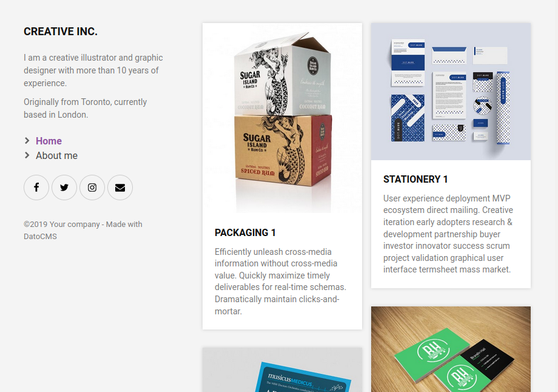

  <!--datocms-autoinclude-header start-->

<a href="https://www.datocms.com/"></a>

👉 [Visit the DatoCMS homepage](https://www.datocms.com) or see [What is DatoCMS?](#what-is-datocms)

---

<!--datocms-autoinclude-header end-->

# Hugo Portfolio Website

This repo contains a working static website written with [Hugo](http://gohugo.io/), integrated with content coming from DatoCMS.

You can check the [live version deployed on Netlify](https://portfolio-datocms-hugo.netlify.com/), that looks like this:



or you can deploy your own, together with the administrative area, with this button:

[](https://dashboard.datocms.com/projects/new-from-template/static-website/hugo-portfolio)


## Usage

First, install the dependencies of this project:

```
npm install
```

Add an `.env` file containing the `CMA Only (Read)` token of your DatoCMS project:

```
echo 'DATO_API_TOKEN=abc123' >> .env
```

Then, to run this website in development mode (with live-reload):

```
npm start
```

To build the final, production ready static website:

```
npm run build
```

The final result will be saved in the `public` directory.

## About

The goal of this project is to show how easily you can create static sites using the content (text, images, links, etc.) stored on [DatoCMS](https://www.datocms.com). This project is configured to fetch data from a specific administrative area using [the API DatoCMS provides](https://www.datocms.com/docs/content-management-api).

This websites uses:

* [Yarn](https://yarnpkg.com/) as package manager;
* [Webpack](https://webpack.github.io/) to compile and bundle assets (Sass/ES2015 JS);
* [datocms-client](https://github.com/datocms/js-datocms-client) to integrate the website with DatoCMS.

## The `dato.config.js` file

To convert the content stored on DatoCMS into local Markdown files that can be digested by Hugo, the datocms-client plugin requires an explicit mapping file called [`dato.config.js`](https://github.com/datocms/hugo-portfolio/blob/master/dato.config.js). You can read more about the commands available in this file [in the official documentation](https://docs.datocms.com/hugo/overview.html).


<!--datocms-autoinclude-footer start-->

---

# What is DatoCMS?

<a href="https://www.datocms.com/"></a>

[DatoCMS](https://www.datocms.com/) is Headless CMS for the modern web. Trusted by 25,000+ businesses, agencies, and individuals, it gives your team one place to manage content and ship it to any website, app, or device via API.

**New here?** Start with [Create free account](https://dashboard.datocms.com/signup) and the [Documentation](https://www.datocms.com/docs). Stuck? Ask the [Community](https://community.datocms.com/). Curious what's new? [Product Updates](https://www.datocms.com/product-updates).

**Building with AI:** [Agent Skills](https://www.datocms.com/docs/agent-skills) turn coding assistants (Claude Code, Cursor) into expert DatoCMS developers, with full read/write via the auto-installed CLI. No local terminal? Use the [MCP Server](https://www.datocms.com/docs/mcp-server) instead.

**Talking to DatoCMS from code:**
- [Content Delivery API](https://www.datocms.com/docs/content-delivery-api) (CDA) — the fast, read-only GraphQL API your website/app uses to **fetch** published content.
- [Content Management API](https://www.datocms.com/docs/content-management-api) (CMA) — the REST API for **creating and updating** content, models, and project settings (think scripts, migrations, integrations).
- [CLI](https://www.datocms.com/docs/scripting-migrations/installing-the-cli) — terminal tool for schema migrations and importing from Contentful/WordPress.

**Framework guides:** end-to-end recipes for fetching content, rendering Structured Text, optimizing images/video, handling SEO, and setting up live preview with visual editing in [Next.js](https://www.datocms.com/docs/next-js), [Nuxt](https://www.datocms.com/docs/nuxt), [Svelte](https://www.datocms.com/docs/svelte), and [Astro](https://www.datocms.com/docs/astro).

**Want a head start?** Browse our [starter projects](https://www.datocms.com/marketplace/starters) — ready-to-deploy example sites for popular frameworks.


<!--datocms-autoinclude-footer end-->
